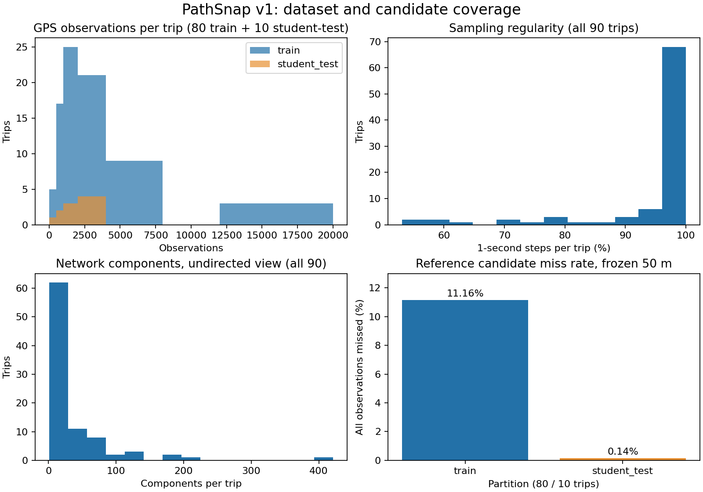

# 2.2 Dataset understanding and EDA (A13 report source)

## Scope and preprocessing

The supplied student dataset has 80 training trips and 10 student-test trips.
The committed inventory covers all 90 trips: 208,417 training and 19,160
student-test GPS observations. Each trip has a timestamped GPS track, its own
road-network nodes and directed arcs, and a separate reference arc sequence.
Arc and node ids are local to each trip, not globally reusable identifiers.
Evaluator data was not used in this work.

Files are whitespace-separated without headers. Coordinates are longitude then
latitude. Distances and bearings are calculated after projecting each trip to a
UTM zone chosen from that trip's track centroid. This matters because the trips
cover different regions and hemispheres; one fixed projected CRS would not fit
all trips. All observations are kept, with their original timestamps and order.
There are no learned preprocessing fits in A's feature pipeline. The saved model
owns its imputation and any other learned preprocessing.

## Quality and patterns

Unless otherwise stated, the following summaries cover all 90 train/student-test
trips and come from `inventory.csv`, `quality.csv` and `network.csv` under
`results/data/`:

- Trip length ranges from 262 to 19,313 observations; the median is 1,496.5.
  Pooled observation metrics therefore give long trips more weight than short
  ones. Report per-trip summaries as well as pooled accuracy.
- There are no missing values, duplicate timestamps or unsorted tracks in those
  committed quality checks. Sampling is not always regular: 66 trips have a gap
  longer than one second. The median per-trip share of one-second steps is
  99.14%, but train trip 22 has only 53.07%. Train trip 90 has the largest gap,
  153,064 seconds. Speed uses the actual time gap, not an assumed one second.
- The median of per-trip median GPS step lengths is 13.18 m. This is not the
  median of all GPS steps pooled together.
- The road graph is directed. The median share of arcs with a reverse arc is
  95.11%, so proximity alone often cannot choose the direction. Networks have
  no isolated nodes in the checks, but have 1 to 421 connected components
  (median 19) when treated as undirected graphs. A route decoder cannot assume
  every pair of candidate roads is reachable.

Figure: aggregate dataset and candidate-coverage summaries, with no raw GPS
coordinates. Recreate with `python -m data_processing.eda_summary`.

The existing GPS/network reference plots `results/data/ref_trip_*.png` and the
train trip diagnostics in `results/data/figures/trip_*_diag_train.png` supply
geographical views. They contain coordinates and should only be reused within
the authorised report/demo audience, not newly published by this handoff. The
required interactive Folium map is supplied by C's map deliverable; this EDA
section does not claim a separate new interactive map was created.

## Reference assignment and limitations

The reference route is an ordered sequence, not a label for each GPS row. The
frozen v1 label is obtained by a minimum-total-distance in-order snap to that
sequence. In the committed reference check over **80 training trips**, the
median consecutive-route connectivity is 100%; median nearest-route distance
across trip medians is 4.5 m; median of trip-level nearest-route 95th percentiles
is 14.25 m. Median per-trip agreement between monotone-snap and nearest-route
arc is 97.5%. These are trip-level summaries, not pooled percentiles or pooled
agreement rates. Reference assignment can be ambiguous near junctions and gaps.

At 50 m, 23,268 of 208,417 training observations miss their reference candidate
(11.16%). Of these, 18,230 have no candidate at all and 5,038 have candidates but
no reference match. Student-test has 27 misses out of 19,160 (0.14%), all on trip
56; none of its observations has zero candidates. These denominators include
**every** observation. Train trips 54 and 33 account for much of the train
coverage problem. Existing diagnostics show that trip 54 is often far from
all network roads, and trip 33 is often near some road but far from the
reference route. The underlying cause is not established. Do not remove these
trips or claim that increasing the radius solves a verified model failure.

## Feature choice and freeze

Candidates are all directed arcs within 50 m of each GPS observation, using a
spatial-index prefilter and exact point-to-segment distance in metres. The ten
frozen features describe absolute/relative proximity (`dist_to_arc`, `dist_rank`,
`dist_minus_min`), local geometry (`proj_frac`, `arc_len`), directional agreement
(`heading_diff`), motion/sampling (`speed`, `dt_prev`), ambiguity (`n_cand`) and
one-hop directed continuity (`conn_prev`). Definitions, dtypes and order are in
`features/FEATURES.md`.

The complete trip is available at inference: heading uses adjacent GPS points,
including the next point, and is not a causal live-streaming feature. No reference
route is used for candidate generation or features. The inference wrapper loads
track/network files with `with_route=False`, then calls exactly the same builder
as training. It returns all GPS rows and an observation sidecar so candidate-free
observations cannot disappear from evaluation.

The 50 m v1 tables have 1,867,152 training candidate rows and 209,121 student-test
candidate rows. Exact inference parity was checked on all 90 trips against the
builder and rebuilt training parquets, with values, dtypes and order preserved.
All 18,230 candidate-free training observations remain in the output sidecar.
Nine synthetic tests cover missing endpoints, all-missing candidates, one-point
tracks, no reference-route reads, invalid ids and partition restrictions. See
`results/data/pipeline_check.json` and `features/PIPELINE.md` for reproduction.

A12 introduced no feature/radius/label changes and did not retrain the model.
Larger radii were explored for coverage only, not tested with all models. Any v2
change requires an explicit team decision, regenerated tables and model reruns;
it is not a prerequisite for this frozen-v1 demo.
